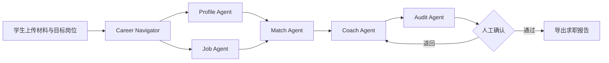

# CampusMatch——高校可信求职协同基座

[🚀 查看 CampusMatch Demo 与复现说明](https://github.com/swj-stone/GOAI/tree/campusmatch-demo/demo)

**中文** / [English](https://github.com/swj-stone/Competition/blob/main/GOAI2026/README_EN.md)

## 项目简介

CampusMatch 是面向高校就业服务中心与在校学生的证据驱动型多 Agent 求职辅助平台。

系统基于 OpenClaw、HiClaw/AgentTeams 和 Higress AI Gateway，由 1 个 Career Navigator 与 5 个专业 Agent 协同完成学生材料解析、岗位要求拆解、证据匹配、求职辅导和安全审计，为学生生成可解释、可追溯、可人工复核的求职分析报告。

CampusMatch 不代替企业作出录用或淘汰决定，也不会根据缺少的简历信息直接判断学生不具备某项能力。

## 选题与落地场景

### 选题名称

**高校可信求职协同基座**

### 落地场景

项目聚焦在校大学生申请实习和校招岗位的真实场景，主要解决以下问题：

- 学生经历分散在简历、课程、项目、社团和志愿活动中，难以形成完整能力画像；
- 岗位 JD 同时包含硬性要求、加分项、模糊描述及潜在歧视性条件；
- 传统岗位匹配系统通常只给出分数，缺少可追溯的证据和解释；
- 生成式 AI 可能将建议误写成真实经历，造成简历内容失真；
- 高校就业老师难以对大量学生持续提供一致、个性化且可审计的辅导。

CampusMatch 将“岗位匹配分”转化为：

> **原文证据 + 岗位要求 + 匹配解释 + 能力缺口 + 行动建议 + 审计结果**

## 核心流程



1. 学生上传简历、课程、项目或社团材料；
2. Profile Agent 提取能力，并保留原文、来源和行号；
3. Job Agent 将 JD 拆分为硬性要求、加分项、岗位职责和风险条件；
4. Match Agent 逐项输出符合、部分符合、缺少证据或风险排除；
5. Coach Agent 基于已有证据生成简历、学习和面试建议；
6. Audit Agent 检查隐私、歧视条件、无证据陈述和审批状态；
7. 只有审计通过且用户人工确认后，系统才允许导出报告。

## Agent 分工

| Agent | 职责 |
|---|---|
| Career Navigator | 识别用户目标、拆解任务、编排 Agent 并汇总结果 |
| Profile Agent | 从学生材料中提取可追溯的能力证据 |
| Job Agent | 规范化岗位要求并识别风险条件 |
| Match Agent | 基于证据计算匹配度和材料覆盖度 |
| Coach Agent | 生成简历优化、学习计划和面试建议 |
| Audit Agent | 执行隐私、公平性、证据和人工审批审计 |

## 核心能力

- **证据化能力画像**：每项能力均关联原文、来源和行号；
- **可解释岗位匹配**：展示逐项要求、匹配状态、证据及原因；
- **公平性控制**：性别、年龄等无关条件标记为 `POLICY_EXCLUDED`，不参与评分；
- **防止经历虚构**：无证据的事实性描述将被 Audit Agent 阻断；
- **人工审批门禁**：未经人工确认时报告不可导出；
- **可复用 Agent Skills**：将画像提取、岗位解析、匹配、辅导和审计封装为独立 Skill；
- **MCP 工具集成**：通过结构化工具契约连接 HiClaw Worker 与业务服务；
- **安全重试机制**：工具调用包含幂等键、权限校验和结构化错误；
- **多端可用**：提供浏览器界面、OpenAPI 接口及 HiClaw AgentTeams 链路。

## Demo 验证结果

项目使用完全合成的学生和岗位数据，保证演示过程可公开、可重复。

| 验证项 | 固定演示结果 |
|---|---:|
| 岗位匹配度 | 77 |
| 证据覆盖度 | 85 |
| 歧视性岗位条件 | `POLICY_EXCLUDED` |
| 人工审批前 | `Audit BLOCK` |
| 人工审批后 | `Audit PASS` |
| 自动化测试 | 50 passed |

以上数据仅用于验证工作流和工程实现，不代表真实录用概率或模型准确率。

## 技术栈

### 当前实现

- **多 Agent 平台**：OpenClaw、HiClaw/AgentTeams
- **AI 网关**：Higress AI Gateway
- **Agent 工程**：Agent Skills、MCP、结构化任务契约
- **后端服务**：Python、FastAPI、Pydantic、Uvicorn
- **模型接入**：LLM、OpenAI-compatible API
- **文档处理**：pypdf、python-docx、Markdown
- **前端界面**：HTML、CSS、JavaScript
- **测试工具**：Pytest、HTTPX
- **工程协作**：Git、GitHub

### 生产化演进

- PostgreSQL/pgvector：任务状态、证据和向量数据持久化；
- RAG：岗位知识、政策规则和职业能力知识检索；
- Docker Compose：多服务一键部署与环境复现；
- OpenTelemetry、AgentLoop/SLS：Agent、Skill、MCP 和 LLM 全链路观测。

## 系统架构

```text
学生 / 高校就业老师
          │
          ▼
Career Navigator（HiClaw Team Leader）
          │
 ┌────────┼────────┬────────┬────────┐
 ▼        ▼        ▼        ▼        ▼
Profile   Job     Match    Coach    Audit
 Agent   Agent    Agent    Agent    Agent
 └────────┴────────┴────────┴────────┘
          │
     Agent Skills
          │
          ▼
   Higress MCP Gateway
          │
          ▼
FastAPI 业务接口 / 文档服务 / 数据与知识服务
```

浏览器 Demo 与 HiClaw AgentTeams 使用同一套确定性业务接口：

- 浏览器链路面向学生、评委和普通体验者；
- AgentTeams 链路用于展示真实任务编排、Worker 委派与 MCP 调用；
- Higress 负责工具注册、访问鉴权、网关治理和调用审计。

## 快速开始

### 环境要求

- Python 3.13+
- PowerShell
- 可选：已运行的 HiClaw/AgentTeams 与 Higress AI Gateway

### 下载项目

```powershell
git clone -b campusmatch-demo https://github.com/swj-stone/GOAI.git
cd GOAI
```

### 安装依赖

```powershell
python -m venv venv
.\venv\Scripts\Activate.ps1
python -m pip install -r requirements.txt
```

### 启动 Demo

```powershell
.\demo\scripts\start-demo.ps1
```

浏览器访问：

```text
http://127.0.0.1:3100
```

OpenAPI 调试页面：

```text
http://127.0.0.1:3100/docs
```

进入页面后点击“载入合成案例”，即可运行完整的证据化求职分析流程。

## HiClaw / MCP 接入

在 HiClaw、Higress 和本地 Demo 服务均已启动后，依次执行：

```powershell
# 注册 CampusMatch MCP
.\demo\scripts\register-hiclaw.ps1

# 配置 Worker MCP 访问
.\demo\scripts\configure-worker-mcp.ps1

# 同步 Agent Skills
.\demo\scripts\sync-worker-skills.ps1

# 执行确定性 MCP 烟雾测试
.\demo\scripts\smoke-hiclaw.ps1 -TaskId smoke-campusmatch-001

# 执行真实 Team Room 委派测试
.\demo\scripts\delegate-team-smoke.ps1 -TaskId team-live-001
```

完整链路依次验证：

```text
Profile → Job → Match → Coach → Audit → Human Approval → Export
```

## 主要接口

| 接口 | 功能 |
|---|---|
| `GET /api/health` | 服务健康检查 |
| `POST /api/v1/documents/convert` | 将文档转换为 Markdown |
| `POST /api/v1/analyze` | 执行完整分析流程 |
| `POST /api/v1/profile` | 生成结构化学生画像 |
| `POST /api/v1/job` | 解析和规范化岗位 JD |
| `POST /api/v1/match` | 执行证据化岗位匹配 |
| `POST /api/v1/coach` | 生成求职辅导建议 |
| `POST /api/v1/audit` | 执行安全审计和审批检查 |
| `GET /api/v1/tasks/{task_id}` | 查询任务执行状态 |
| `GET /api/v1/reports/{task_id}.md` | 导出已通过审计的报告 |

## 运行测试

```powershell
.\venv\Scripts\Activate.ps1
python -m pip check
python -m pytest demo\tests -q
```

## 项目结构

```text
GOAI/
├─ demo/
│  ├─ src/campusmatch/       # FastAPI、规则服务和浏览器界面
│  ├─ tests/                 # 单元、接口、安全和契约测试
│  ├─ fixtures/              # 完全合成的固定演示数据
│  ├─ agentteams/            # Agent、Skills 与 MCP 配置
│  └─ scripts/               # 启动、注册和烟雾测试脚本
├─ show/                     # 比赛方案、PPT 与验收材料
├─ requirements.txt
└─ 参赛手册.md
```

## 安全与使用边界

- 本项目是求职准备辅助工具，不是自动招聘或候选人淘汰系统；
- 匹配度表示当前材料对岗位要求的证据覆盖，不代表录用概率；
- `NO_EVIDENCE` 表示材料中没有证据，不代表用户不具备该能力；
- 敏感属性和歧视性条件不会进入匹配评分；
- 系统不会自动生成不存在的项目、经历或量化成果；
- 报告必须通过 Audit Agent 审计并获得人工确认后才能导出；
- Demo 仅使用合成数据，不应提交真实简历、API Key 或访问令牌。

## 当前限制

- 当前任务状态保存在 FastAPI 进程内存中，服务重启后会清空；
- 扫描版 PDF 暂不支持 OCR；
- 当前画像抽取和匹配采用确定性规则，以保证 Demo 可复现；
- PostgreSQL/pgvector、RAG 和完整可观测系统属于后续生产化建设内容；
- 项目当前是可复现的 Agent Infra MVP，不是生产级招聘平台。

## 项目价值

CampusMatch 将传统的黑盒岗位匹配升级为可解释、可验证、可审计的求职协同流程，并将核心能力沉淀为可复用 Agent Skills 和 MCP 工具，可进一步复用于：

- 高校就业服务中心；
- 职业培训与求职辅导机构；
- 校招与实习信息平台；
- 企业内部人才发展与岗位能力分析。
