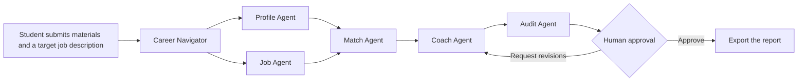

# CampusMatch — A Trustworthy Multi-Agent Platform for University Career Services
[中文](https://github.com/swj-stone/Competition/blob/main/GOAI2026/README.md) / **English**

[🚀 CampusMatch demo and instructions for reproducing the results](https://github.com/swj-stone/GOAI/tree/campusmatch-demo/demo)

## Overview

CampusMatch helps university career centers and students assess how well a student's documented experience meets the requirements of a particular job. For each requirement, it shows what the student has demonstrated and where the supporting evidence appears.

Built on OpenClaw, HiClaw/AgentTeams, and Higress AI Gateway, the platform uses a Career Navigator to coordinate five specialized agents. Together they extract evidence from student materials, break down job descriptions, match evidence to requirements, provide career guidance, and audit the results. The resulting report lets students and advisers trace each assessment back to its source and review it themselves.

Employers retain responsibility for hiring and rejection decisions. When a résumé contains no evidence of a skill, CampusMatch records that gap in the documentation without drawing a conclusion about the student's ability.

## Project Theme and Use Case

### Project Theme

**A Trustworthy Multi-Agent Platform for University Career Services**

### Use Case

CampusMatch focuses on university students applying for internships and graduate roles through campus recruitment. Students and career advisers face several practical problems:

- Evidence of a student's skills is scattered across résumés, coursework, projects, student organizations, and volunteer work.
- A single job description may mix mandatory requirements, preferred qualifications, vague expectations, and potentially discriminatory criteria.
- Conventional job-matching systems often return a score with little explanation or traceable evidence.
- Generative AI can present a suggested activity as something the student has already done, introducing inaccuracies into a résumé.
- University career advisers need to provide consistent, personalized guidance to many students while keeping a record others can review.

CampusMatch accompanies each job-match score with:

> **Source excerpts · Job requirements · Reasons for each match · Gaps to address · Recommended next steps · Audit findings**

## Core Workflow



1. The student submits a résumé or materials from coursework, projects, or student organizations.
2. The **Profile Agent** identifies skills and records the original passage, source, and line numbers for each one.
3. The **Job Agent** separates the job description into mandatory requirements, preferred qualifications, responsibilities, and potentially problematic criteria.
4. The **Match Agent** assesses each requirement and assigns one of four outcomes: met, partially met, no supporting evidence, or excluded on policy grounds.
5. The **Coach Agent** uses the available evidence to suggest résumé edits, learning goals, and interview preparation.
6. The **Audit Agent** checks for privacy issues, discriminatory criteria, and unsupported claims. It also verifies the approval status.
7. The user can export the report once it passes the audit and the user approves it.

## Agent Roles

| Agent | Responsibilities |
|---|---|
| Career Navigator | Identifies the user's goal, breaks it into tasks, coordinates the agents, and combines their findings. |
| Profile Agent | Extracts evidence of skills from student materials and records where each piece of evidence came from. |
| Job Agent | Normalizes job requirements and flags potentially problematic criteria. |
| Match Agent | Scores the match against the requirements and measures how much of the job description the submitted evidence covers. |
| Coach Agent | Suggests résumé improvements, develops learning plans, and helps the student prepare for interviews. |
| Audit Agent | Checks privacy, fairness, supporting evidence, and human approval. |

## Key Capabilities

- **Traceable skill profiles.** Each skill links to the original passage, its source, and its line numbers.
- **Explainable job matching.** Each requirement appears alongside its match status, supporting evidence, and rationale.
- **Fairness controls.** The system marks irrelevant criteria such as gender or age as `POLICY_EXCLUDED` and omits them from scoring.
- **Checks against fabricated experience.** The Audit Agent blocks factual claims that lack supporting evidence.
- **Human approval.** Export requires explicit user approval.
- **Reusable Agent Skills.** Profile extraction, job parsing, matching, coaching, and auditing are packaged as individual skills.
- **MCP tool integration.** Structured tool contracts connect HiClaw workers to the application services.
- **Safe retries.** Tool calls use idempotency keys, permission checks, and structured errors.
- **Multiple interfaces.** Users can access the workflow through a browser, the OpenAPI interface, or HiClaw AgentTeams.

## Demo Results

The demo uses a fixed set of synthetic student and job data so anyone can share the example and reproduce the results.

| Check | Result for the demo case |
|---|---:|
| Job-match score | 77 |
| Evidence coverage score | 85 |
| Discriminatory job criterion | `POLICY_EXCLUDED` |
| Before human approval | `Audit BLOCK` |
| After human approval | `Audit PASS` |
| Automated tests | 50 passed |

These results verify the workflow and its implementation on the demo case. They measure neither the likelihood of a job offer nor model accuracy.

## Technology Stack

### Current Implementation

| Component | Technologies |
|---|---|
| Multi-agent platforms | OpenClaw, HiClaw/AgentTeams |
| AI gateway | Higress AI Gateway |
| Agent development | Agent Skills, MCP, structured task contracts |
| Backend | Python, FastAPI, Pydantic, Uvicorn |
| Model integration | Large language models (LLMs) via an OpenAI-compatible API |
| Document processing | pypdf, python-docx, Markdown |
| Browser interface | HTML, CSS, JavaScript |
| Testing | pytest, HTTPX |
| Version control and collaboration | Git, GitHub |

### Production Roadmap

- **PostgreSQL and pgvector** for persistent storage of task state, evidence, and vector data.
- **Retrieval-augmented generation (RAG)** to retrieve information about roles, policy rules, and occupational skills.
- **Docker Compose** to deploy the services together and reproduce the environment with one command.
- **OpenTelemetry and AgentLoop/SLS** for end-to-end observability across agents, skills, MCP calls, and LLM calls.

## System Architecture

```text
                Students and university career advisers
                                  │
                                  ▼
                 Career Navigator (HiClaw Team Leader)
                                  │
       ┌────────────┬─────────────┼─────────────┬────────────┐
       ▼            ▼             ▼             ▼            ▼
  Profile Agent  Job Agent    Match Agent   Coach Agent  Audit Agent
       └────────────┴─────────────┼─────────────┴────────────┘
                                  │
                                  ▼
                             Agent Skills
                                  │
                                  ▼
                          Higress MCP Gateway
                                  │
                                  ▼
        FastAPI endpoints / Document services / Data and knowledge services
```

The browser demo and HiClaw AgentTeams use the same deterministic service APIs.

- The browser interface lets students, judges, and other visitors try the workflow.
- The AgentTeams workflow demonstrates live task orchestration, worker delegation, and MCP tool calls.
- Higress handles tool registration, access control, gateway policies, and auditing of tool calls.

## Quick Start

### Requirements

- Python 3.13 or later
- PowerShell
- Optional for the local demo: running instances of HiClaw/AgentTeams and Higress AI Gateway

### Clone the Demo Branch

```powershell
git clone -b campusmatch-demo https://github.com/swj-stone/GOAI.git
cd GOAI
```

### Install Dependencies

```powershell
python -m venv venv
.\venv\Scripts\Activate.ps1
python -m pip install -r requirements.txt
```

### Start the Demo

```powershell
.\demo\scripts\start-demo.ps1
```

Open the [browser demo](http://127.0.0.1:3100) and select **载入合成案例** (“Load synthetic case”) to run the full analysis. To inspect or try individual API endpoints, open the [interactive OpenAPI documentation](http://127.0.0.1:3100/docs).

## HiClaw and MCP Integration

With HiClaw, Higress, and the local demo service running, execute the following commands in order:

```powershell
# Register the CampusMatch MCP service
.\demo\scripts\register-hiclaw.ps1

# Configure MCP access for workers
.\demo\scripts\configure-worker-mcp.ps1

# Sync Agent Skills
.\demo\scripts\sync-worker-skills.ps1

# Run the deterministic MCP smoke test
.\demo\scripts\smoke-hiclaw.ps1 -TaskId smoke-campusmatch-001

# Test live delegation in a Team Room
.\demo\scripts\delegate-team-smoke.ps1 -TaskId team-live-001
```

The end-to-end test covers the following sequence:

```text
Profile → Job → Match → Coach → Audit → Human Approval → Export
```

## API Endpoints

| Endpoint | Purpose |
|---|---|
| `GET /api/health` | Check service health. |
| `POST /api/v1/documents/convert` | Convert a document to Markdown. |
| `POST /api/v1/analyze` | Run the complete analysis workflow. |
| `POST /api/v1/profile` | Generate a structured student profile. |
| `POST /api/v1/job` | Parse and normalize a job description. |
| `POST /api/v1/match` | Match evidence from student materials to job requirements. |
| `POST /api/v1/coach` | Generate guidance for the student's job search. |
| `POST /api/v1/audit` | Run safety and approval checks. |
| `GET /api/v1/tasks/{task_id}` | Retrieve task status. |
| `GET /api/v1/reports/{task_id}.md` | Export the Markdown report after audit and approval. |

## Run the Tests

```powershell
.\venv\Scripts\Activate.ps1
python -m pip check
python -m pytest demo\tests -q
```

## Project Structure

```text
GOAI/
├─ demo/
│  ├─ src/campusmatch/       # FastAPI application, rule-based services, and browser UI
│  ├─ tests/                 # Unit, API, safety, and contract tests
│  ├─ fixtures/              # Fixed synthetic demo data
│  ├─ agentteams/            # Agent, skill, and MCP configuration
│  └─ scripts/               # Startup, registration, and smoke-test scripts
├─ show/                     # Competition proposal, presentation slides, and acceptance materials
├─ requirements.txt
└─ 参赛手册.md                # Competition handbook
```

## Safety and Intended Use

- CampusMatch supports students preparing job applications. Automated hiring and candidate rejection are outside its scope.
- The match score reflects how well the submitted materials document the job requirements. It does not predict the probability of a job offer.
- `NO_EVIDENCE` means the submitted materials contain no supporting evidence for that requirement. The student's actual ability remains undetermined.
- The system excludes sensitive attributes and discriminatory criteria from the match score.
- The system does not invent projects, experience, or quantified achievements.
- Export requires both a successful Audit Agent review and explicit human approval.
- Use synthetic data for the demo. Keep real résumés, API keys, and access tokens out of submissions.

## Current Limitations

- The FastAPI process stores task state in memory. Restarting the service clears that state.
- OCR for scanned PDFs is not yet supported.
- Profile extraction and matching currently use deterministic rules to keep the demo reproducible.
- Persistent storage with PostgreSQL/pgvector, RAG, and full observability are planned for a future production implementation.
- The current release is a reproducible minimum viable product (MVP) for agent infrastructure. A production recruitment platform is outside the scope of this release.

## Applications

CampusMatch makes job matching a process that students and advisers can explain, verify, and audit. Its Agent Skills and MCP tools can also be reused by:

- University career centers
- Vocational training providers and career coaching organizations
- Platforms for campus recruitment and internship listings
- Employers developing internal talent and analyzing the skills required for specific roles

